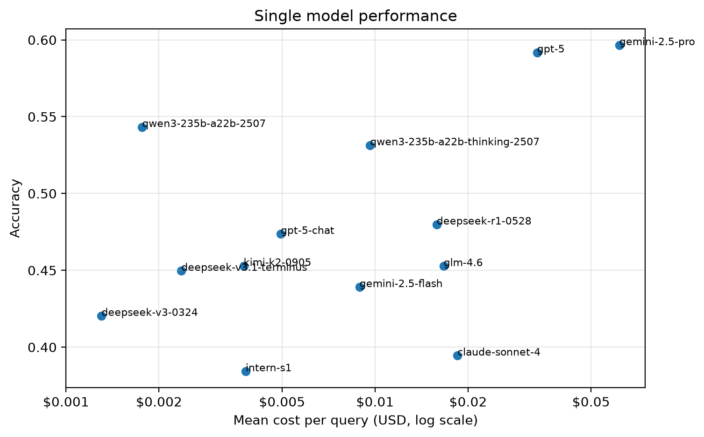

# Model Routing with Guarantees

Large language models differ widely in price, and many queries do not need
the most expensive one. This project routes each query to a cheaper model
when it is safe to do so, and falls back to a strong reference model
otherwise. The routing threshold is calibrated with Learn Then Test (LTT),
which gives a statistical guarantee on how often routing costs a correct
answer compared with always using the reference.

## Method

1. **Scorer.** For each query and model, estimate the chance of a correct
   answer as the share of the 40 most similar training queries (MiniLM
   embeddings, kNN) that the model answered correctly.
2. **Router.** One threshold `λ`. Try the candidate models from cheapest to
   most expensive and pick the first whose score is above `λ`. If none is,
   use the reference model (`gemini-2.5-pro`).
3. **Loss.** A query is a failure when the routed model is wrong and the
   reference would have been right (reference regret). The risk `R(λ)` is
   the share of all queries that are failures.
4. **Calibration.** On held-out calibration queries, test each `λ` from
   1.00 downwards with an exact binomial p-value and stop at the first one
   that fails (fixed-sequence testing). The last `λ` that passed is `λ̂`.
5. **Guarantee.** For a target risk `α` and error level `δ` (0.10 here):

$$\Pr\big(R(\hat\lambda) \le \alpha\big) \ge 1 - \delta$$

The probability is over the draw of the calibration set. 

## Repository layout

| Path | Contents |
| --- | --- |
| `data/data_processing.py` | Builds `data.parquet` from the LLMRouterBench release |
| `data/data_loader.py` | Loads the data as query x model matrices (`correct`, `cost`) |
| `router.py` | Split, scorer, candidate order, router and loss matrix |
| `ltt.py` | Binomial p-value, fixed-sequence test and calibration |
| `experiments/common.py` | Shared helpers: fit, calibrate inputs, evaluation |
| `experiments/single_models.py` | Accuracy, cost and reference regret of each model alone |
| `experiments/repeated_trials.py` | LTT and an uncalibrated baseline across target risks `α`, over 100 random splits |
| `tests/` | Unit tests for `ltt.py` and `router.py` |
| `results/` | Tables and figures written by the experiments |

## Setup

Requires Python 3.10 or later.

```bash
pip install -r requirements.txt
```

Then download and build the data as described under [Data](#data).

## Running

Run everything from the repository root.

```bash
python -m pytest
python -m experiments.single_models
python -m experiments.repeated_trials
```

The first experiment run computes the MiniLM embeddings of all prompts and
caches them in `data/processed/embeddings.npy`.

## Results

**Single models.** Cost is a poor proxy for quality: some cheap models come
close to the reference at a small fraction of its price.



**Risk control.** Over 100 random splits at a target risk of 0.10
Full table: `results/repeated_trials/summary.csv`.

## Data

This project uses the released results of LLMRouterBench
([Li et al., 2026, arXiv:2601.07206](https://arxiv.org/abs/2601.07206)).
The benchmark already ran every model on every query, graded each answer and
recorded its cost, so this repository never calls an LLM.

We use the **performance-cost track**: 13 flagship models on 10 datasets
(12,446 queries). It records both correctness and cost, which is what a
router that saves cost under a quality guarantee needs. From each result we
keep only the prompt, the score and the cost.

### Models

| Model (id in the data) | Input price | Output price |
| --- | --- | --- |
| `claude-sonnet-4` | $3.00 / 1M | $15.00 / 1M |
| `gemini-2.5-flash` | $0.30 / 1M | $2.50 / 1M |
| `gemini-2.5-pro` | $1.25 / 1M | $10.00 / 1M |
| `gpt-5-chat` | $1.25 / 1M | $10.00 / 1M |
| `gpt-5` (GPT-5-medium) | $1.25 / 1M | $10.00 / 1M |
| `qwen3-235b-a22b-2507` | $0.09 / 1M | $0.60 / 1M |
| `qwen3-235b-a22b-thinking-2507` | $0.30 / 1M | $2.90 / 1M |
| `deepseek-v3-0324` | $0.25 / 1M | $0.88 / 1M |
| `deepseek-v3.1-terminus` | $0.27 / 1M | $1.00 / 1M |
| `deepseek-r1-0528` | $0.50 / 1M | $2.15 / 1M |
| `glm-4.6` | $0.60 / 1M | $2.20 / 1M |
| `kimi-k2-0905` | $0.50 / 1M | $2.00 / 1M |
| `intern-s1` | $0.18 / 1M | $0.54 / 1M |

Prices are per million tokens, as listed by LLMRouterBench. We use the
recorded per-query cost.

### Datasets

| Category | Dataset (id in the data) | Queries | Metric |
| --- | --- | --- | --- |
| Math | AIME (`aime`) | 60 | Accuracy |
| Math | LiveMathBench (`livemathbench`) | 121 | Accuracy |
| Code | LiveCodeBench (`livecodebench`) | 1,055 | Pass@1 |
| Code | SWE-Bench (`swe-bench`) | 500 | Pass@1 |
| Knowledge | GPQA (`gpqa`) | 198 | Accuracy |
| Knowledge | HLE (`hle`) | 2,158 | LLM judge |
| Knowledge | MMLU-Pro (`mmlupro`) | 3,000 | Accuracy |
| Knowledge | SimpleQA (`simpleqa`) | 4,326 | LLM judge |
| Instruction following | ArenaHard (`arenahard`) | 750 | LLM judge |
| Tool use | τ²-Bench (`tau2`) | 278 | Success rate |

All evaluations are 0-shot.

### Download

1. Download `bench-release.tar.gz` from
   [Hugging Face](https://huggingface.co/datasets/NPULH/LLMRouterBench).
2. Place it in `data/raw/` and extract it:

```bash
   cd data/raw && tar -xzf bench-release.tar.gz
```

   This creates `data/raw/bench-release/`. The release also contains other
   datasets and models; the build step selects the ones above.

### Build

```bash
pip install -r requirements.txt
python data/data_processing.py
```

This selects the 129 performance-cost result files from the release and
writes `data/processed/data.parquet`: one row per (query, model), with
columns `dataset_id`, `record_index`, `model`, `prompt`, `score`, `cost`.

Expected output: `Saved data.parquet: 161520 rows, 12446 queries, 129 files`.

### Conventions and data notes

- **Query key:** `(dataset_id, record_index)`. Indices start at 1.
- **Correctness:** a score of at least 0.5 counts as correct. Scores of
  0.5 occur only in ArenaHard (2,149 rows, judge ties).
- **Missing pair:** `gpt-5-chat` has no τ²-Bench results in the release
  (278 queries). In the loaded matrices these cells count as not correct
  and have no cost (`NaN`), so cost averages use `np.nanmean`.
- **Prompt variants:** 2 queries (`arenahard` 103, `hle` 1494) have a
  slightly different prompt for one model. One version is kept per query;
  the difference is cosmetic.
- **Zero costs:** 2,226 rows (1.4%) have a cost of 0. Most (2,088) are
  scored 0 and are likely failed calls; 132 are correct gpt-5 answers on
  HLE with no recorded cost. They are kept, so a few models
  look slightly cheaper than they are.